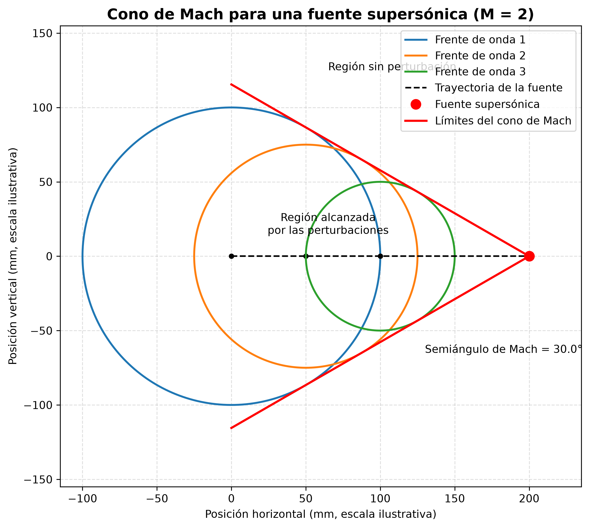
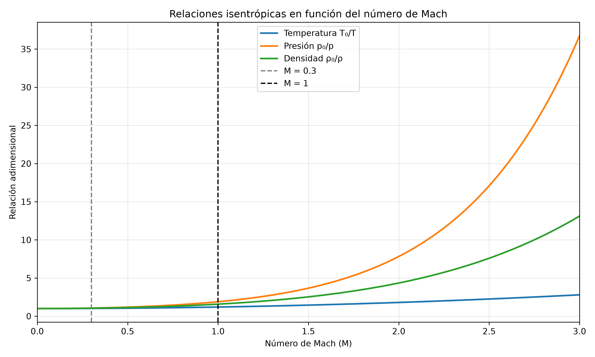
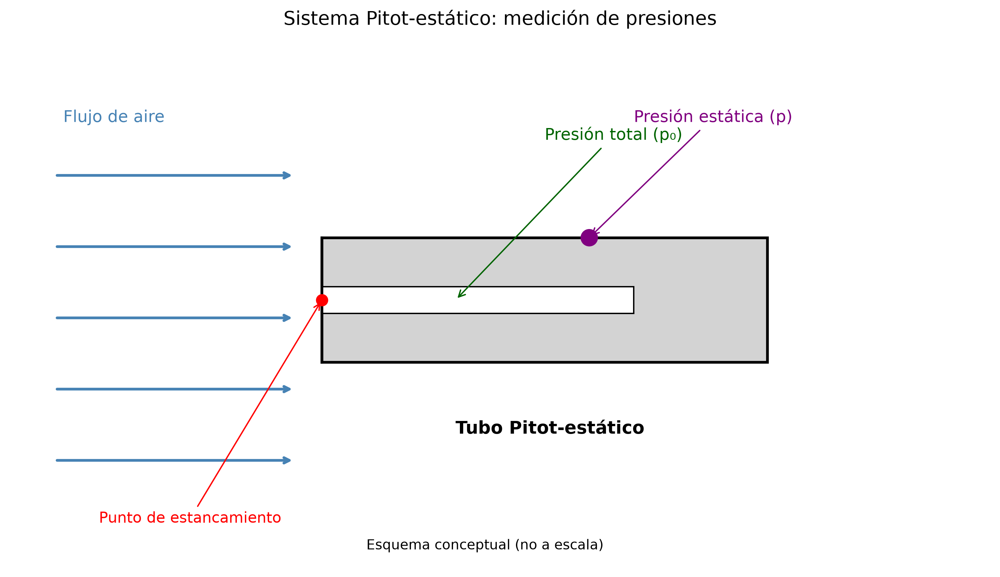

# Aerodinámica II — Tarea 1
## Fundamentos del flujo compresible

Este repositorio contiene los diagramas desarrollados para la Parte B de la Tarea 1 de Aerodinámica II.

Los diagramas se realizaron utilizando Python, NumPy y Matplotlib.

### Diagrama 1. Cono de Mach

Representación del cono de Mach para un flujo supersónico con M = 2 y un semiángulo de 30°.

**Código:** [tarea1_diagramas.py](tarea1_diagramas.py)

### Diagrama 2. Relaciones isentrópicas

Gráfica de las relaciones de temperatura, presión y densidad en función del número de Mach, considerando aire con γ = 1.4.

Se identifican los valores M = 0.3 y M = 1.

**Código:** [diagrama2_isentropicas.py](diagrama2_isentropicas.py)

### Diagrama 3. Sistema Pitot-estático

Esquema conceptual que identifica la presión total, la presión estática y el punto de estancamiento.

**Código:** [diagrama3_pitot.py](diagrama3_pitot.py)

---

**Asignatura:** Aerodinámica II  
**Actividad:** Tarea 1 — Parte B